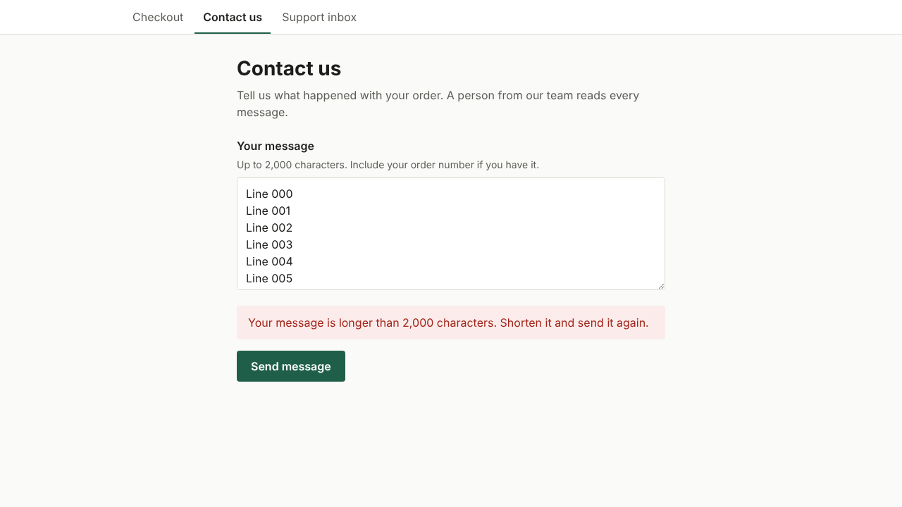

# Exploratory session: contact-form

Branch `exploration/2026-10-23-contact-form`. 1 finding(s); each one is an issue titled "Exploration: <title>".

## 1. A message within the limit is refused when it has many line breaks (bug)

Breaks: AGENTS.md section 5: every error has a way out (the page promises up to 2,000 characters)

1. Go to /contact
2. Paste a message of 1,990 characters with 221 line breaks (the browser counts 1,990 and does not mark it too long)
3. Click Send message

Expected: The message is sent: it is within the 2,000 characters the page announces and the browser enforces.

Actual: HTTP 422 and “Your message is longer than 2,000 characters. Shorten it and send it again.” The form sends each line break as CRLF, so the server counts 2,211 characters. The customer cannot see what to shorten.

